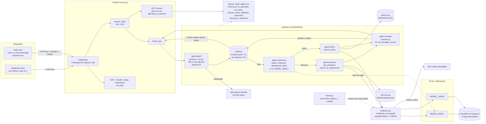
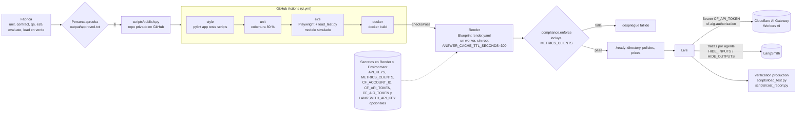
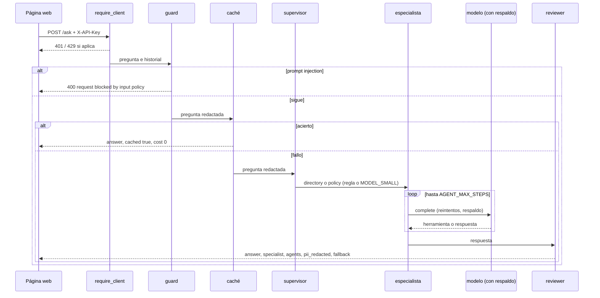

# Arquitectura del HR Assistant (sesiones 1 a 4 y reto)

El HR Assistant responde preguntas del personal de RH sobre empleados y políticas. Es una API
FastAPI sin estado con una página web y un tablero. Las sesiones 1 a 4 dieron el agente con
bucle con tope, la observabilidad, el modelo real con palancas de costo y la puesta en
producción (claves por cliente, límite, compliance, contenedor, CI y Render). El reto lo
convierte en un sistema multi-agente: un guardián a la entrada, un supervisor que reparte entre
dos especialistas (`directory` y `policy`), un revisor a la salida, una caché de respuestas,
reintentos con modelo de respaldo, mínimo privilegio en `/metrics`, auditoría y métricas de
negocio.

## Documentos

- [Seguridad](security.md): modelo de amenazas y tabla de controles (dónde vive cada uno y qué
  prueba lo comprueba).
- [Costos](costs.md): palancas, evidencia de `verification evaluate` contra la línea base y
  trade-offs entre costo y calidad.
- [Operación](operations.md): despliegue en Render, variables, CI, pruebas de humo y de carga,
  tablero, `/metrics`, LangSmith y qué hacer ante 502, respaldo, 429 y 403.
- [Lista de compliance](compliance-checklist.md): reglas de producción revisadas al arrancar.

## Sistema multi-agente

## Despliegue

## Secuencia de una pregunta

## Decisiones

- [0001 API sin estado con historial en el cliente](adr/0001-stateless-api.md)
- [0002 Modelo detrás de una interfaz e inyección de dependencias](adr/0002-model-interface-and-injection.md)
- [0003 Un solo agente con bucle con tope y protocolo JSON](adr/0003-bounded-agent-loop.md)
- [0004 Id por petición y log JSON sin datos personales](adr/0004-request-id-and-json-logs.md)
- [0005 Métricas en memoria por proceso](adr/0005-in-process-metrics.md)
- [0006 Trazas opcionales con LangSmith detrás de un Tracer](adr/0006-optional-langsmith-tracing.md)
- [0007 Modelo real detrás de la interfaz, con cliente HTTP inyectado](adr/0007-gateway-model-behind-interface.md)
- [0008 Enrutamiento por regla y ventana de historial](adr/0008-rule-based-routing-and-history-window.md)
- [0009 Costo por respuesta y modelos simulados con precio](adr/0009-cost-per-answer-and-priced-fake-models.md)
- [0010 Clave por cliente y límite de peticiones en memoria](adr/0010-per-client-api-keys-and-rate-limit.md)
- [0011 Compliance como código: el producto se niega a arrancar](adr/0011-compliance-as-code-at-startup.md)
- [0012 Contenedor, CI en cuatro etapas y Render con checksPass](adr/0012-container-ci-and-render-checks-pass.md)
- [0013 Supervisor con reglas antes que modelo](adr/0013-supervisor-rules-before-model.md)
- [0014 Guardián de entrada y revisor de salida en código](adr/0014-guard-and-reviewer-in-code.md)
- [0015 Caché de respuestas en proceso](adr/0015-in-process-answer-cache.md)

## Configuración

| Variable | Por omisión | Validación |
| --- | --- | --- |
| `ENVIRONMENT` | `development` | `development` o `production`; con `production` se aplican las reglas de compliance |
| `API_KEYS` | vacía | `cliente:clave,...`; secreto; error con posición y largo, nunca el valor |
| `RATE_LIMIT_PER_MINUTE` | `30` | Entero mayor que 0; por cliente |
| `MODEL_PROVIDER` | `fake` | `fake` o `gateway`; en producción no puede ser `fake` |
| `CF_ACCOUNT_ID`, `CF_GATEWAY_ID`, `CF_API_TOKEN` | vacía, `default`, vacía | Obligatorias con `gateway`; el token no se muestra nunca |
| `MODEL_SMALL` | `@cf/meta/llama-3.1-8b-instruct-fast` | No vacío y con precio |
| `MODEL_LARGE` | `@cf/meta/llama-3.3-70b-instruct-fp8-fast` | No vacío y con precio |
| `ROUTING` | `true` | `true` o `false` |
| `ROUTER_MAX_CHARS` | `80` | Entero mayor que 0 |
| `HISTORY_WINDOW` | `6` | Entero mayor o igual a 0 |
| `MODEL_MAX_TOKENS` | `300` | Entero mayor que 0 |
| `MODEL_TEMPERATURE` | `0` | Decimal mayor o igual a 0 |
| `CACHE_TTL_SECONDS` | `0` | Entero mayor o igual a 0 (0: sin caché) |
| `PRICES_PATH` | `data/model_prices.json` | Relativo a `product/`; el archivo debe existir |
| `AGENT_MAX_STEPS` | `3` | Entero mayor que 0 |
| `MAX_QUESTION_CHARS` | `2000` | Entero mayor que 0 |
| `EMPLOYEES_PATH` | `data/employees.json` | Relativo a `product/`; el archivo debe existir |
| `SERVICE_NAME` | `hr-assistant` | Texto no vacío |
| `SLO_P95_MS` | `2000` | Entero mayor que 0 |
| `LANGSMITH_TRACING` | `false` | `true` o `false`; sin `LANGSMITH_API_KEY` no se traza |
| `HIDE_INPUTS` / `HIDE_OUTPUTS` | `true` | `true` o `false`; en producción con trazas deben ser `true` |
| `MAX_ANSWER_CHARS` | `1500` | Entero mayor que 0; el revisor recorta la respuesta |
| `MODEL_RETRIES` | `2` | Entero, 0 o más; solo timeout, 429 y 5xx |
| `MODEL_RETRY_BACKOFF_SECONDS` | `0.5` | Número, 0 o más; espera exponencial inyectada |
| `MODEL_FALLBACK` | `true` | `true` o `false`; repite el especialista una vez con el otro modelo |
| `FAKE_UNAVAILABLE_MODELS` | vacía | Solo con `MODEL_PROVIDER=fake`; modelos simulados caídos |
| `CF_AIG_TOKEN` | vacía | Secreto opcional; encabezado `cf-aig-authorization` |
| `METRICS_CLIENTS` | vacía | Clientes de `API_KEYS` que leen `/metrics`; obligatoria en producción |
| `ANSWER_CACHE_TTL_SECONDS` | `0` | Entero, 0 o más (0: caché apagada; 300 en Render) |
| `ANSWER_CACHE_MAX_ENTRIES` | `256` | Entero mayor que 0 |
| `POLICIES_PATH` | `data/policies.json` | Relativo a `product/`; el archivo debe existir |
| `PORT` | `8000` | Lo pone Render; solo lo usa el `CMD` del contenedor |

Los secretos (`API_KEYS`, `CF_API_TOKEN`, `CF_AIG_TOKEN`, `LANGSMITH_API_KEY`) nunca se escriben en el log, en
la traza, en un error, en `.env.example` ni en el repositorio. En Render, `API_KEYS`, `CF_ACCOUNT_ID`,
`CF_API_TOKEN` y `METRICS_CLIENTS` van en el Blueprint (`render.yaml`) con `sync: false`: Render pide su valor
y no lo guarda en el repositorio. `CF_AIG_TOKEN` y `LANGSMITH_API_KEY` no están en el Blueprint: si se usan, se
agregan a mano en Render > Environment.
